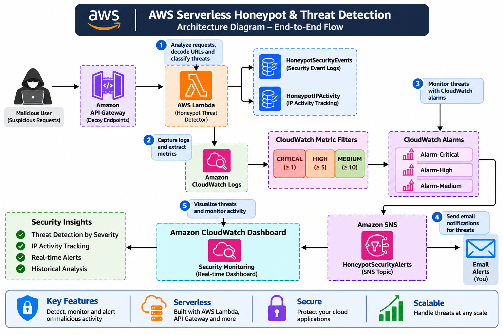

# AWS Serverless Honeypot & Threat Detection Dashboard

## Project Overview

This project demonstrates how to build a serverless honeypot and threat detection solution on AWS to identify, classify, monitor, and alert on suspicious HTTP requests.

The solution uses Amazon API Gateway to expose decoy endpoints, AWS Lambda to inspect incoming requests and classify potential threats, and Amazon DynamoDB to store security events and track suspicious activity by source IP.

Amazon CloudWatch provides centralized logging, metric filtering, alarm monitoring, and security dashboards, while Amazon SNS delivers automated email notifications when configured threat thresholds are reached.

The project demonstrates serverless architecture, cloud security monitoring, threat detection, event-driven processing, and automated security alerting.

## Architecture Diagram



## AWS Services Used

| AWS Service | Purpose |
|---|---|
| Amazon API Gateway | Exposes public decoy HTTP endpoints |
| AWS Lambda | Inspects requests and classifies suspicious activity |
| Amazon DynamoDB | Stores security events and source IP activity |
| Amazon CloudWatch Logs | Captures Lambda execution and security event logs |
| Amazon CloudWatch Metric Filters | Extracts threat severity metrics from logs |
| Amazon CloudWatch Alarms | Monitors suspicious activity thresholds |
| Amazon CloudWatch Dashboard | Visualizes threat activity and alarm status |
| Amazon SNS | Sends automated email notifications |

## Key Features

- **Suspicious Request Detection:** Identifies suspicious requests targeting common administrative and sensitive file paths.
- **Threat Classification:** Categorizes detected activity into CRITICAL, HIGH, MEDIUM, and LOW severity levels.
- **URL Decoding:** Decodes URL-encoded paths and query strings to identify suspicious patterns.
- **IP Activity Tracking:** Tracks repeated suspicious requests from individual source IP addresses within five-minute windows.
- **Severity Escalation:** Escalates threat severity based on repeated suspicious activity.
- **Security Event Logging:** Stores detected events and associated metadata in DynamoDB.
- **Automated Monitoring:** Uses CloudWatch metric filters and alarms to monitor threat activity.
- **Email Notifications:** Sends automated SNS notifications when configured alarm thresholds are reached.
- **Security Dashboard:** Provides centralized visibility into threat severity and alarm status.

## Threat Detection Rules

The Lambda function examines incoming request paths and query strings against predefined detection patterns.

| Severity | Detection Category | Example Indicators |
|---|---|---|
| CRITICAL | Sensitive File Probing | `/.env`, `/wp-config.php`, `/etc/passwd` |
| HIGH | SQL Injection | `union select`, `OR 1=1` |
| HIGH | Directory Traversal | `../` |
| HIGH | Cross-Site Scripting | `<script` |
| MEDIUM | Reconnaissance | `/admin`, `/wp-login.php`, `/phpmyadmin`, `/.git` |
| LOW | Normal or unmatched requests | Requests without matching detection patterns |

The solution also tracks repeated suspicious requests and applies severity escalation based on activity thresholds.

## DynamoDB Data Storage

### 1. HoneypotSecurityEvents

Stores individual security events detected by the Lambda function.

Key attributes include:

- `eventId`
- `timestamp`
- `sourceIp`
- `path`
- `method`
- `userAgent`
- `severity`
- `originalSeverity`
- `attackCategory`
- `suspiciousCount`
- `queryString`

### 2. HoneypotIPActivity

Tracks suspicious request activity by source IP address within fixed five-minute windows.

Key attributes include:

- `sourceIp`
- `windowStart`
- `suspiciousCount`
- `expiresAt`

DynamoDB TTL is configured using `expiresAt` to allow expired activity records to be removed automatically.

## Threat Monitoring and Alerting

CloudWatch Metric Filters extract threat severity information from Lambda security event logs.

**Custom Metric Namespace:** `HoneypotSecurityMetrics`

| Metric Filter | Metric Name | Alarm Threshold |
|---|---|---|
| `HoneypotCriticalThreats` | `CriticalThreatCount` | ≥ 1 |
| `HoneypotHighThreats` | `HighThreatCount` | ≥ 5 |
| `HoneypotMediumThreats` | `MediumThreatCount` | ≥ 10 |

All three alarms use a five-minute evaluation period and are configured to publish notifications to the SNS topic:

`HoneypotSecurityAlerts`

The SNS topic delivers email notifications when an alarm transitions into the ALARM state.

These thresholds are demonstration settings and should be adjusted for real-world traffic patterns.

## CloudWatch Dashboard

The project includes a centralized CloudWatch dashboard named:

`HoneypotSecurityDashboard`

The dashboard contains four monitoring widgets:

1. **Honeypot Alarm Status** – Displays the current status of all three CloudWatch alarms.
2. **Critical Threat Activity** – Tracks CRITICAL threat metrics.
3. **High Threat Activity** – Tracks HIGH threat metrics.
4. **Medium Threat Activity** – Tracks MEDIUM threat metrics.

## Implementation and Deployment

All AWS resources were configured manually through the AWS Management Console.

The implementation was completed in the following phases:

| Phase | Implementation |
|---|---|
| 1 | Created DynamoDB security event table |
| 2 | Developed Lambda threat detection function |
| 3 | Configured API Gateway HTTP API and decoy endpoints |
| 4 | Tested threat detection and implemented URL decoding |
| 5 | Implemented IP activity tracking and severity escalation |
| 6 | Configured CloudWatch monitoring, alarms, dashboard, and SNS notifications |
| 7 | Performed end-to-end validation and testing |

### API Gateway Decoy Endpoints

The HTTP API exposes selected routes for monitoring suspicious requests, including:

- `/`
- `/admin`
- `/login`
- `/wp-login.php`
- `/.env`
- `/.git`
- `/phpmyadmin`
- `/api/{proxy+}`

## Testing and Validation

The solution was tested using PowerShell HTTP requests.

Example tests:

**1. Reconnaissance Detection**
```powershell
Invoke-RestMethod -Uri "$($API)/admin" -Method GET
```

Expected initial classification: `MEDIUM`

**2. SQL Injection Detection**
```powershell
Invoke-RestMethod -Uri "$($API)/login?username=admin%20OR%201=1" -Method GET
```

Expected initial classification: `HIGH`

**3. Sensitive File Probing**
```powershell
Invoke-RestMethod -Uri "$($API)/.env" -Method GET
```

Expected initial classification: `CRITICAL`

### Validation Results

- Verified suspicious requests were processed by API Gateway and Lambda.
- Confirmed threat categories and severity classifications.
- Verified security events were stored in DynamoDB.
- Confirmed source IP activity tracking and request counters.
- Verified CloudWatch metric filters generated threat metrics.
- Confirmed all three CloudWatch alarms transitioned into the ALARM state during testing.
- Successfully received SNS email notifications for CRITICAL, HIGH, and MEDIUM alarm transitions.
- Verified the CloudWatch dashboard displayed threat metrics and alarm status.

## Security Considerations and Limitations

- This honeypot is designed for controlled request monitoring and detection, not exploitation.
- Incoming requests are inspected for predefined suspicious indicators; payloads are not executed.
- Detection is based on request paths and query strings, so it does not provide comprehensive inspection of request bodies or all attack techniques.
- A detected indicator does not prove that an attack succeeded.
- Source IP tracking may be affected by shared NAT addresses, proxies, or changing IP addresses.
- Detection rules and escalation thresholds require tuning to reduce false positives.
- The public decoy API should be monitored and protected against abuse and unexpected costs.
- AWS IAM permissions should follow the principle of least privilege.

## Skills Demonstrated

- AWS Serverless Architecture
- Cloud Security Monitoring
- Threat Detection and Classification
- AWS Lambda and Python
- Amazon API Gateway
- Amazon DynamoDB
- Amazon CloudWatch Logs and Metrics
- CloudWatch Metric Filters and Alarms
- Amazon SNS Notifications
- Event-Driven Security Monitoring
- AWS IAM and Least-Privilege Access

## Project Category

**Primary:** Security

**Secondary:**
- Serverless Web Application
- Cloud Application Deployment

## Disclaimer

This project is intended for educational and portfolio demonstration purposes. It uses controlled decoy endpoints and predefined detection patterns to demonstrate security monitoring capabilities. It is not a replacement for a production-grade intrusion detection or prevention system.
